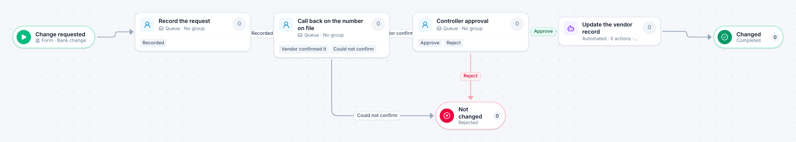

# Vendor bank change

[Starter templates](../TEMPLATES.md) › Finance and AP

A request to change a vendor’s bank details is confirmed by a call-back to the number already on file, made by someone other than the person who took the request, before the controller approves it.

4 steps · 3 people steps · 1 step for a system of yours. Each item is a **Bank change**. Tags: fraud control, four eyes, accounts payable.

## Steps

| Step | Kind | What it does | Then |
| --- | --- | --- | --- |
| **Change requested** | Start | Someone fills in the form. | → Record the request |
| **Record the request** | Person | A queue: any member of the group claims it. Due in 1 day. | **Recorded** → Call back on the number on file |
| **Call back on the number on file** | Person | A queue: any member of the group claims it. Due in 2 days. Not the person who did “Record the request”. | **Vendor confirmed it** → Controller approval **Could not confirm** (with a comment) → Not changed |
| **Controller approval** | Person | A queue: any member of the group claims it. Due in 1 day. Not the person who did “Record the request” or “Call back on the number on file”. | **Approve** → Update the vendor record **Reject** (with a comment) → Not changed |
| **Not changed** | End | Ends the item as Rejected. |  |
| **Update the vendor record** | Automated | **Your system.** A placeholder until you point it at a service of your own; until then it takes its time and passes the item on. | → Changed |
| **Changed** | End | Ends the item as Completed. |  |

## Fields

| Field | Type | Notes |
| --- | --- | --- |
| Vendor | Text | Required · Shown on work cards |
| Requested By (at the vendor) | Text | Required |
| Request Letter | Attachment |  |
| Call-back Notes | Long text |  |

## Use it

In the Studio, open **Templates** and find **Vendor bank change**. Start a new application from it, or add it to an application you have and map its fields onto yours.

Then make it your own: pick the group that does each people step, point the steps marked *your system* at your services, change the thresholds and deadlines, publish, and run the simulation to watch work move through it.

---

← [New vendor setup](new-vendor-setup.md) · [All templates](../TEMPLATES.md) · [Check request](check-request.md) →
