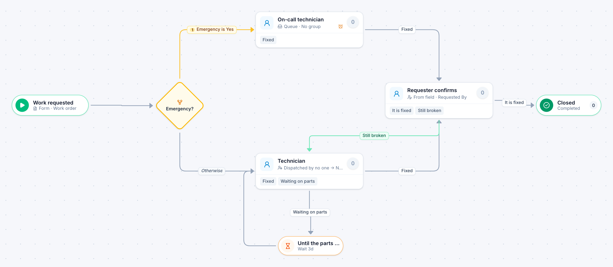

# Work order

[Starter templates](../TEMPLATES.md) › Facilities, fleet and safety

Emergencies go straight to the on-call technician. Routine work is handed out by a dispatcher, can wait on parts, and closes only when the person who asked confirms it is fixed.

5 steps · 3 people steps. Each item is a **Work order**. Tags: dispatcher, waiting on parts, maintenance request.

## Steps

| Step | Kind | What it does | Then |
| --- | --- | --- | --- |
| **Work requested** | Start | Someone fills in the form. | → Emergency? |
| **Emergency?** | Decision | Checks its rules from the top; the first one that matches wins. | **Emergency is Yes** → On-call technician **Otherwise** → Technician |
| **On-call technician** | Person | A queue: any member of the group claims it. Due in 2 hours. Escalates after 1 hour. | **Fixed** → Requester confirms |
| **Technician** | Person | A dispatcher hands each item to someone. Due in 3 days. | **Fixed** → Requester confirms **Waiting on parts** (with a comment) → Until the parts arrive |
| **Until the parts arrive** | Timer | Waits 3 days. | → Technician |
| **Requester confirms** | Person | Goes to the person named in “Requested By”. Due in 2 days. | **It is fixed** → Closed **Still broken** (with a comment) → Technician |
| **Closed** | End | Ends the item as Completed. |  |

## Fields

| Field | Type | Notes |
| --- | --- | --- |
| Location | Text | Required · Shown on work cards |
| Problem | Long text | Required |
| Emergency | Yes / No |  |
| Requested By | Person | Required |

## Use it

In the Studio, open **Templates** and find **Work order**. Start a new application from it, or add it to an application you have and map its fields onto yours.

Then make it your own: pick the group that does each people step, change the thresholds and deadlines, publish, and run the simulation to watch work move through it.

---

← [Security incident](security-incident.md) · [All templates](../TEMPLATES.md) · [Vehicle repair](vehicle-repair.md) →
